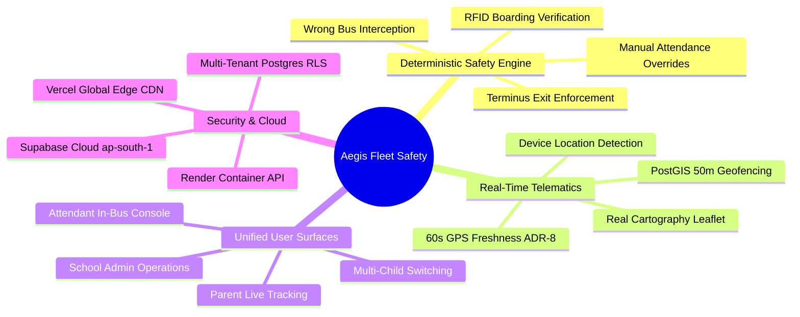
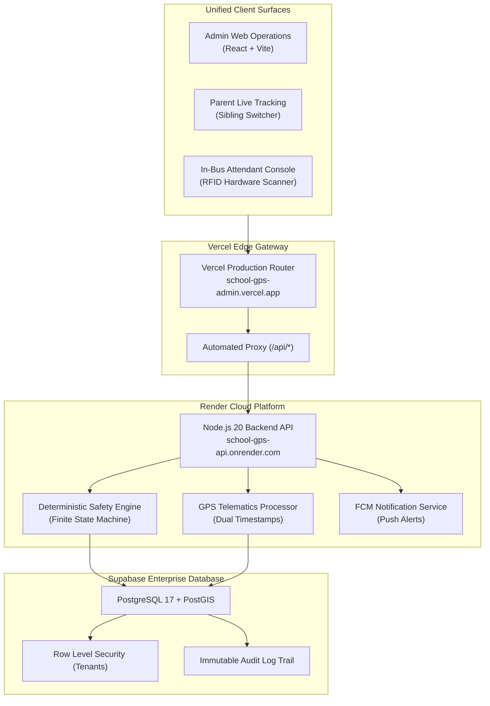

# 🛡️ Aegis — School Transport Safety & Accountability Platform

> **Mission-Critical Student Safety, Deterministic Journey Verification, and Live GPS Fleet Telematics.**  
> Built for K-12 school districts, enterprise fleet operators, and transport authorities.

[](https://school-gps-admin-adityak05s-projects.vercel.app)
[](https://school-gps-api.onrender.com)
[](https://supabase.com)
[](https://github.com/AdityaK05/School_GPS)

---

## 🌐 Live Production Deployments

| Component | Target Role | URL | Status |
| :--- | :--- | :--- | :---: |
| **Unified Web Portal** | School Admin, Parents & Attendants | [school-gps-admin-adityak05s-projects.vercel.app](https://school-gps-admin-adityak05s-projects.vercel.app) | 🟢 **LIVE** |
| **Backend Safety Engine** | Telematics, RFID Ingestion & REST API | [school-gps-api.onrender.com](https://school-gps-api.onrender.com) | 🟢 **LIVE** |
| **API Health Check** | System Monitoring & Uptime | [school-gps-api.onrender.com/api/v1/health](https://school-gps-api.onrender.com/api/v1/health) | 🟢 **HEALTHY** |
| **Supabase Cloud** | PostgreSQL 17 + PostGIS + RLS | `wsddukyzfpazndprbnsr` (`ap-south-1`) | 🟢 **HEALTHY** |

*Tip: The unified web portal features an instant **Role Switcher** in the top navigation bar to toggle between **🛡️ Admin Ops**, **👨‍👩‍👧 Parent View**, and **🚌 Attendant Scanner**.*

---

## 🗺️ System Mindmap

```text
                               AEGIS SAFETY PLATFORM
                                         │
    ┌──────────────────┬─────────────────┴─────────────────┬──────────────────┐
    ▼                  ▼                                   ▼                  ▼
STUDENT SAFETY     FLEET TELEMATICS                   MULTI-ROLE UI      DATA & AUDIT
 ├── RFID Scans     ├── Dual-Timestamp GPS Ingestion   ├── Admin Console  ├── Multi-Tenant RLS
 ├── Journey Engine ├── 60s Freshness Threshold (ADR-8)├── Parent App     ├── Immutable Logs
 ├── Wrong Bus Inter├── 50m PostGIS Geofence Rings     └── Attendant App  ├── UUIDv7 Idempotency
 └── Terminus Exit  └── Real Cartographic Streets                         └── Offline Queue Sync
```



---

## 🏗️ Architecture Diagram



---

## 🚀 How to Run Locally

### Prerequisites
* **Node.js**: `v20.x` or higher
* **npm**: `v10.x` or higher

### Quick Start
```bash
# 1. Clone the repository
git clone https://github.com/AdityaK05/School_GPS.git
cd School_GPS

# 2. Install workspace dependencies
npm install

# 3. Start Backend API Server (Port 3000)
npm run dev:api

# 4. In a second terminal, start Admin Web & Portal (Port 5173)
npm run dev:admin

# 5. Open in your browser:
# http://localhost:5173
```

### Verification & Testing
```bash
# Run strict TypeScript typecheck across all monorepo packages
npm run typecheck

# Run full Vitest suite (75 tests across 8 suites)
npm run test:run

# Execute full end-to-end trip simulation with 0 safety faults
npm run simulate
```

---

## 🗺️ Real Live Map & Free API Key Guide

The platform integrates a **real live cartographic map** with interactive streets, satellite imagery, animated bus markers, and device geolocation.

### Free Map Options:

| Provider | Cost | API Key Required? | Details |
| :--- | :--- | :---: | :--- |
| **CartoDB Dark Matter** *(Default)* | **100% Free** | **NO** | Pre-configured out of the box. Crisp dark mode streets, road names, and building footprints worldwide. |
| **OpenStreetMap Standard** | **100% Free** | **NO** | Standard daylight community street maps. Toggle with one click on the map. |
| **ArcGIS World Imagery** | **100% Free** | **NO** | Real satellite imagery tiles worldwide. |
| **Google Maps Platform** | **Free (\$200/mo credit)** | **YES** *(Optional)* | Google Cloud gives \$200 free credit monthly (~28,500 map loads/month). Set `VITE_GOOGLE_MAPS_API_KEY` in `.env.local`. |
| **Mapbox GL** | **Free (50k loads/mo)** | **YES** *(Optional)* | Sign up at [mapbox.com](https://mapbox.com) for a free public token (`pk.eyJ...`). |

---

## 📂 Documentation Index

All in-depth technical specifications, architecture decisions, and operational runbooks are located in the [`docs/`](file:///d:/School_GPS/docs/) folder:

* [`docs/HLD.md`](file:///d:/School_GPS/docs/HLD.md) — High-Level Architecture Design & Threat Model.
* [`docs/LLD.md`](file:///d:/School_GPS/docs/LLD.md) — Low-Level Component Architecture, Database Schemas & State Transitions.
* [`docs/architecture-decisions.md`](file:///d:/School_GPS/docs/architecture-decisions.md) — Key Architectural Decision Records (ADRs 1–10).
* [`docs/DEPLOYMENT_GUIDE.md`](file:///d:/School_GPS/docs/DEPLOYMENT_GUIDE.md) — Production Deployment Walkthrough for Vercel, Render, and Supabase.
* [`docs/ENVIRONMENT_CONFIG.md`](file:///d:/School_GPS/docs/ENVIRONMENT_CONFIG.md) — Complete Environment Variable Classification & Inventory.
* [`docs/OPERATIONS_RUNBOOK.md`](file:///d:/School_GPS/docs/OPERATIONS_RUNBOOK.md) — Incident Response, Exception Handling & Disaster Recovery.
* [`docs/SECURITY_AUDIT.md`](file:///d:/School_GPS/docs/SECURITY_AUDIT.md) — Multi-Tenant Row Level Security, Token Authorization & Secret Scans.
* [`docs/TESTING_SUITE.md`](file:///d:/School_GPS/docs/TESTING_SUITE.md) — 75-Test Automated Suite Verification & Hardware Simulations.

---

## ⚖️ License
Proprietary & Confidential — Aegis Fleet Safety OS. All Rights Reserved.
